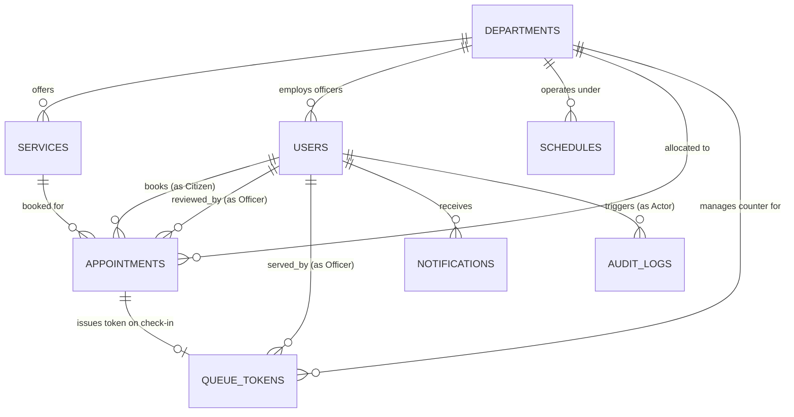

# Woreda Booking and Appointment Management System (WoredaCare)
## Production Database Design Specification (`Database.md`)

---

## 1. Executive Summary & Design Principles

This database architecture is designed based on the **actual client-side implementation** of the **Woreda Booking and Appointment Management System (WoredaCare)**. 

The system operates in the municipal governance domain of Ethiopia, providing citizen-to-government (C2G) and internal administration (G2G) appointment scheduling, counter queue dispatch, document verification, and administrative management across three strict Role-Based Access Control (RBAC) tiers:
1. **`CITIZEN`**: Self-service appointment booking, tracking, status updates, rescheduling, and notification inbox.
2. **`OFFICER`**: Departmental desk officer reviewing requests (`PENDING` -> `APPROVED` / `REJECTED`), in-person document verification, queue token issuance (`CHECKED_IN`), live counter queue calling (`SERVING`), and service completion (`COMPLETED` / `NO_SHOW`).
3. **`ADMIN`**: Central woreda administration, departmental CRUD, public service catalog management, operating schedule and daily capacity parameters, staff account provisioning, cross-department appointment master audit, analytics export, and security audit logs.

### Primary Engine Selection
- **Database Engine**: **PostgreSQL 16+**
- **Character Encoding**: `UTF8` (fully supports Amharic/Ge'ez text as well as English)
- **Timezone**: `Africa/Addis_Ababa` (UTC+3, consistent with the live municipal clock)
- **ID Strategy**: UUIDv7 (`uuid`) for distributed safety and time-ordered clustering, alongside human-readable business identifiers:
  - Appointment Reference Numbers: `WRD-YYYYMMDD-XXXX` (e.g., `WRD-20261102-4821`)
  - Queue Tokens: `{DEPT_CODE}-{DAILY_SEQ:02d}` (e.g., `KBL-01`, `LND-02`)

---

## 2. Entity-Relationship Overview (ERD)



---

## 3. Enumerations & Custom Types

```sql
-- Role-based access control tiers strictly implemented in the client
CREATE TYPE user_role AS ENUM (
    'CITIZEN',
    'OFFICER',
    'ADMIN'
);

-- Core appointment lifecycle state machine
CREATE TYPE appointment_status AS ENUM (
    'PENDING',      -- Submitted by citizen; awaiting officer review
    'APPROVED',     -- Approved by desk officer; slot confirmed
    'REJECTED',     -- Rejected by officer with documented reason
    'CHECKED_IN',   -- Citizen verified at reception desk; token issued
    'IN_PROGRESS',  -- Citizen called to counter desk
    'COMPLETED',    -- Service delivered and finalized
    'CANCELLED',    -- Cancelled online by citizen prior to visit
    'NO_SHOW'       -- Citizen failed to arrive or answer queue calls
);

-- Real-time counter queue token dispatch status
CREATE TYPE queue_status AS ENUM (
    'WAITING',      -- Checked-in, in waiting hall
    'SERVING',      -- Currently at counter desk #1/counter desk #2
    'COMPLETED',    -- Counter service finalized
    'NO_SHOW'       -- Token called 3 times without appearance
);

-- In-app notification alert category
CREATE TYPE notification_type AS ENUM (
    'INFO',
    'SUCCESS',
    'WARNING',
    'ALERT'
);

-- Schedule status for working operating hours
CREATE TYPE schedule_status AS ENUM (
    'ACTIVE',
    'INACTIVE'
);
```

---

## 4. Database Schema Definitions

### 4.1. `departments`
Stores municipal Woreda administrative departments (e.g., Kebele Administration, Land Administration, Trade & Enterprise Development, Revenue & Tax).

```sql
CREATE TABLE departments (
    id VARCHAR(64) PRIMARY KEY, -- e.g. 'dept-1' or UUIDv7
    code VARCHAR(16) NOT NULL UNIQUE, -- e.g. 'KBL', 'LND', 'TRD', 'TAX', 'SOC'
    name VARCHAR(255) NOT NULL,
    description TEXT,
    building_room VARCHAR(255) NOT NULL, -- e.g. 'Building A, Ground Floor, Room 102'
    contact_phone VARCHAR(32) NOT NULL, -- e.g. '+251 11 551 2341'
    is_active BOOLEAN NOT NULL DEFAULT TRUE,
    created_at TIMESTAMPTZ NOT NULL DEFAULT CURRENT_TIMESTAMP,
    updated_at TIMESTAMPTZ NOT NULL DEFAULT CURRENT_TIMESTAMP
);
```

### 4.2. `services`
Stores public municipal services offered by specific departments, including document requirements, processing timeline, fees, and quota limits.

```sql
CREATE TABLE services (
    id VARCHAR(64) PRIMARY KEY, -- e.g. 'srv-1' or UUIDv7
    department_id VARCHAR(64) NOT NULL REFERENCES departments(id) ON DELETE RESTRICT,
    code VARCHAR(32) NOT NULL UNIQUE, -- e.g. 'KBL-DID', 'KBL-RES'
    name VARCHAR(255) NOT NULL,
    description TEXT,
    duration_minutes INTEGER NOT NULL DEFAULT 30 CHECK (duration_minutes > 0),
    daily_quota INTEGER NOT NULL DEFAULT 40 CHECK (daily_quota > 0),
    fee_etb NUMERIC(10, 2) NOT NULL DEFAULT 0.00 CHECK (fee_etb >= 0),
    processing_days VARCHAR(128) NOT NULL DEFAULT 'Same day', -- e.g. 'Same day', '2-3 business days'
    required_documents JSONB NOT NULL DEFAULT '[]'::jsonb, -- Array of strings (e.g. ["Kebele ID", "Passport Photo"])
    is_active BOOLEAN NOT NULL DEFAULT TRUE,
    created_at TIMESTAMPTZ NOT NULL DEFAULT CURRENT_TIMESTAMP,
    updated_at TIMESTAMPTZ NOT NULL DEFAULT CURRENT_TIMESTAMP
);
```

### 4.3. `schedules`
Stores operating configurations, working days, daily appointment capacity, and opening/closing hours per department or service.

```sql
CREATE TABLE schedules (
    id VARCHAR(64) PRIMARY KEY, -- e.g. 'SCH-001' or UUIDv7
    department_id VARCHAR(64) NOT NULL REFERENCES departments(id) ON DELETE CASCADE,
    service_id VARCHAR(64) REFERENCES services(id) ON DELETE SET NULL,
    working_days JSONB NOT NULL DEFAULT '["Mon", "Tue", "Wed", "Thu", "Fri"]'::jsonb, -- e.g. ["Mon","Tue","Wed","Thu","Fri"]
    opening_time TIME NOT NULL DEFAULT '08:30:00',
    closing_time TIME NOT NULL DEFAULT '17:30:00',
    daily_capacity INTEGER NOT NULL DEFAULT 40 CHECK (daily_capacity > 0),
    effective_start_date DATE NOT NULL DEFAULT CURRENT_DATE,
    effective_end_date DATE,
    status schedule_status NOT NULL DEFAULT 'ACTIVE',
    created_at TIMESTAMPTZ NOT NULL DEFAULT CURRENT_TIMESTAMP,
    updated_at TIMESTAMPTZ NOT NULL DEFAULT CURRENT_TIMESTAMP,
    CONSTRAINT chk_schedule_hours CHECK (closing_time > opening_time),
    CONSTRAINT chk_effective_dates CHECK (effective_end_date IS NULL OR effective_end_date >= effective_start_date)
);
```

### 4.4. `users`
Unified identity table managing citizens, department desk officers, and woreda central administrators.

```sql
CREATE TABLE users (
    id VARCHAR(64) PRIMARY KEY, -- e.g. 'usr-admin', 'usr-officer-1', 'usr-citizen-1'
    full_name VARCHAR(255) NOT NULL,
    email VARCHAR(255) NOT NULL UNIQUE,
    phone VARCHAR(32) NOT NULL, -- e.g. '+251911223344'
    password_hash VARCHAR(255) NOT NULL, -- Argon2id or bcrypt hash
    national_id VARCHAR(64) NOT NULL UNIQUE, -- e.g. 'ET-CIT-5582', 'ET-EMP-1029', 'ET-ADM-9901'
    role user_role NOT NULL DEFAULT 'CITIZEN',
    department_id VARCHAR(64) REFERENCES departments(id) ON DELETE SET NULL, -- Populated for OFFICER role
    counter_number INTEGER DEFAULT NULL CHECK (counter_number IS NULL OR counter_number > 0), -- Officer counter desk #
    address VARCHAR(255) DEFAULT NULL, -- Citizen residence (e.g. 'Kebele 04, House No. 412')
    is_active BOOLEAN NOT NULL DEFAULT TRUE,
    created_at TIMESTAMPTZ NOT NULL DEFAULT CURRENT_TIMESTAMP,
    updated_at TIMESTAMPTZ NOT NULL DEFAULT CURRENT_TIMESTAMP,
    CONSTRAINT chk_officer_department CHECK (
        (role = 'OFFICER' AND department_id IS NOT NULL) OR
        (role <> 'OFFICER')
    )
);
```

### 4.5. `appointments`
The central transaction table holding all citizen booking submissions, schedule dates, status progressions, and verification records.

```sql
CREATE TABLE appointments (
    id VARCHAR(64) PRIMARY KEY, -- e.g. 'apt-1' or UUIDv7
    reference_number VARCHAR(64) NOT NULL UNIQUE, -- e.g. 'WRD-20261102-4821'
    citizen_id VARCHAR(64) NOT NULL REFERENCES users(id) ON DELETE RESTRICT,
    citizen_name VARCHAR(255) NOT NULL,
    citizen_phone VARCHAR(32) NOT NULL,
    citizen_email VARCHAR(255),
    department_id VARCHAR(64) NOT NULL REFERENCES departments(id) ON DELETE RESTRICT,
    service_id VARCHAR(64) NOT NULL REFERENCES services(id) ON DELETE RESTRICT,
    appointment_date DATE NOT NULL, -- e.g. '2026-11-02'
    time_slot VARCHAR(16) NOT NULL, -- e.g. '09:00 AM', '14:30 PM'
    status appointment_status NOT NULL DEFAULT 'PENDING',
    token_number VARCHAR(32) DEFAULT NULL, -- e.g. 'KBL-01'
    citizen_notes TEXT DEFAULT NULL,
    officer_notes TEXT DEFAULT NULL,
    rejection_reason TEXT DEFAULT NULL, -- Documented when status = 'REJECTED'
    responsible_officer_id VARCHAR(64) REFERENCES users(id) ON DELETE SET NULL,
    checked_in_at TIMESTAMPTZ DEFAULT NULL,
    completed_at TIMESTAMPTZ DEFAULT NULL,
    created_at TIMESTAMPTZ NOT NULL DEFAULT CURRENT_TIMESTAMP,
    updated_at TIMESTAMPTZ NOT NULL DEFAULT CURRENT_TIMESTAMP
);
```

### 4.6. `queue_tokens`
Manages daily live counter queues and lobby display dispatch when citizens check in physically at the service desk.

```sql
CREATE TABLE queue_tokens (
    id VARCHAR(64) PRIMARY KEY, -- e.g. 'q-1' or UUIDv7
    appointment_id VARCHAR(64) NOT NULL UNIQUE REFERENCES appointments(id) ON DELETE CASCADE,
    token_number VARCHAR(32) NOT NULL, -- e.g. 'KBL-01', 'LND-02'
    department_id VARCHAR(64) NOT NULL REFERENCES departments(id) ON DELETE RESTRICT,
    counter_number INTEGER NOT NULL DEFAULT 1,
    officer_id VARCHAR(64) REFERENCES users(id) ON DELETE SET NULL,
    status queue_status NOT NULL DEFAULT 'WAITING',
    checked_in_time TIME NOT NULL DEFAULT CURRENT_TIME,
    called_time TIME DEFAULT NULL,
    estimated_minutes_remaining INTEGER NOT NULL DEFAULT 15,
    queue_date DATE NOT NULL DEFAULT CURRENT_DATE,
    created_at TIMESTAMPTZ NOT NULL DEFAULT CURRENT_TIMESTAMP,
    updated_at TIMESTAMPTZ NOT NULL DEFAULT CURRENT_TIMESTAMP
);
```

### 4.7. `notifications`
Stores in-app alerts and notifications generated for citizens, desk officers, and administrators.

```sql
CREATE TABLE notifications (
    id VARCHAR(64) PRIMARY KEY, -- e.g. 'notif-1' or UUIDv7
    user_id VARCHAR(64) NOT NULL REFERENCES users(id) ON DELETE CASCADE,
    title VARCHAR(255) NOT NULL,
    message TEXT NOT NULL,
    type notification_type NOT NULL DEFAULT 'INFO',
    is_read BOOLEAN NOT NULL DEFAULT FALSE,
    created_at TIMESTAMPTZ NOT NULL DEFAULT CURRENT_TIMESTAMP
);
```

### 4.8. `audit_logs`
Records security, administrative, and status transition audit events.

```sql
CREATE TABLE audit_logs (
    id VARCHAR(64) PRIMARY KEY, -- e.g. 'log-1' or UUIDv7
    user_id VARCHAR(64) REFERENCES users(id) ON DELETE SET NULL,
    user_name VARCHAR(255) NOT NULL,
    user_role VARCHAR(32) NOT NULL, -- e.g. 'ADMIN', 'OFFICER', 'CITIZEN'
    action VARCHAR(64) NOT NULL, -- e.g. 'CREATE_BOOKING', 'STATUS_APPROVED', 'UPDATE_SCHEDULE'
    entity VARCHAR(255) NOT NULL, -- e.g. 'WRD-20261102-4821', 'Global Schedule'
    details TEXT,
    ip_address VARCHAR(45) NOT NULL DEFAULT '127.0.0.1',
    created_at TIMESTAMPTZ NOT NULL DEFAULT CURRENT_TIMESTAMP
);
```

### 4.9. `system_settings`
Stores administrative municipal configuration key-values.

```sql
CREATE TABLE system_settings (
    id VARCHAR(32) PRIMARY KEY DEFAULT 'primary',
    woreda_name VARCHAR(255) NOT NULL DEFAULT 'Woreda 03 Public Administration',
    city_region VARCHAR(255) NOT NULL DEFAULT 'Addis Ababa City Administration',
    hotline VARCHAR(32) NOT NULL DEFAULT '9840',
    reception_phone VARCHAR(32) NOT NULL DEFAULT '+251 11 551 0000',
    sms_gateway_active BOOLEAN NOT NULL DEFAULT TRUE,
    auto_approve_bookings BOOLEAN NOT NULL DEFAULT FALSE,
    advance_booking_days INTEGER NOT NULL DEFAULT 14,
    cancellation_cutoff_hours INTEGER NOT NULL DEFAULT 4,
    max_parallel_slots INTEGER NOT NULL DEFAULT 3,
    updated_at TIMESTAMPTZ NOT NULL DEFAULT CURRENT_TIMESTAMP
);
```

---

## 5. Performance Optimization & Indexing Strategies

### 5.1. B-Tree Indexes for High-Frequency Query Paths

```sql
-- 1. Officer Appointment Registry Filtering (Filtered by Department, Date, and Status)
CREATE INDEX idx_appointments_dept_date_status 
ON appointments(department_id, appointment_date, status);

-- 2. Citizen Appointment History Querying
CREATE INDEX idx_appointments_citizen_history 
ON appointments(citizen_id, created_at DESC);

-- 3. Instant Public & In-Portal Tracking via Reference Number
CREATE UNIQUE INDEX idx_appointments_reference_number 
ON appointments(reference_number);

-- 4. Search Lookup by Phone Number
CREATE INDEX idx_appointments_citizen_phone 
ON appointments(citizen_phone);

-- 5. Live Queue Board Lookup
CREATE INDEX idx_queue_tokens_dept_status 
ON queue_tokens(department_id, queue_date, status);

-- 6. User Login & Authentication Lookup
CREATE UNIQUE INDEX idx_users_email_lower 
ON users(LOWER(email));

CREATE UNIQUE INDEX idx_users_national_id 
ON users(national_id);

-- 7. Unread Notification Counter
CREATE INDEX idx_notifications_user_unread 
ON notifications(user_id) 
WHERE is_read = FALSE;

-- 8. Audit Log Time-Series Ordering
CREATE INDEX idx_audit_logs_created_at_desc 
ON audit_logs(created_at DESC);
```

### 5.2. Concurrency Control & Overbooking Prevention
In municipal booking desks, multiple citizens may attempt to book the last remaining slot for a service simultaneously. 

#### Partial Unique Index Constraint for Slots
To physically prevent double-booking beyond the configured capacity:
```sql
-- Prevents active bookings from exceeding concurrent service capacity for identical date and timeSlot
-- (When combined with a slot counter check or advisory lock)
CREATE INDEX idx_active_bookings_slot 
ON appointments(service_id, appointment_date, time_slot) 
WHERE status NOT IN ('CANCELLED', 'REJECTED');
```

#### Atomic Booking Transaction with Advisory Row Locking
When reserving a slot:
```sql
BEGIN;

-- Lock active bookings for this service and slot to evaluate remaining capacity atomically
SELECT COUNT(*) 
FROM appointments 
WHERE service_id = $1 
  AND appointment_date = $2 
  AND time_slot = $3 
  AND status NOT IN ('CANCELLED', 'REJECTED')
FOR UPDATE;

-- If count < max_parallel_slots: proceed with INSERT
INSERT INTO appointments (
    id, reference_number, citizen_id, citizen_name, citizen_phone,
    citizen_email, department_id, service_id, appointment_date,
    time_slot, status, citizen_notes
) VALUES (
    $4, $5, $6, $7, $8, $9, $10, $11, $12, $13, 'PENDING', $14
);

COMMIT;
```

### 5.3. Table Partitioning Strategy
For long-term production scaling across thousands of citizen bookings:
- **`appointments`**: Range-partitioned by `appointment_date` (Yearly or Quarterly partitions, e.g., `appointments_2026_q1`, `appointments_2026_q2`).
- **`audit_logs`**: Range-partitioned by `created_at` with cold storage archival for records older than 12 months.

---

## 6. Data Integrity & Automated Triggers

### 6.1. Updated Timestamp Trigger
```sql
CREATE OR REPLACE FUNCTION set_updated_at_timestamp()
RETURNS TRIGGER AS $$
BEGIN
    NEW.updated_at = CURRENT_TIMESTAMP;
    RETURN NEW;
END;
$$ LANGUAGE plpgsql;

CREATE TRIGGER trg_departments_updated_at BEFORE UPDATE ON departments FOR EACH ROW EXECUTE FUNCTION set_updated_at_timestamp();
CREATE TRIGGER trg_services_updated_at BEFORE UPDATE ON services FOR EACH ROW EXECUTE FUNCTION set_updated_at_timestamp();
CREATE TRIGGER trg_schedules_updated_at BEFORE UPDATE ON schedules FOR EACH ROW EXECUTE FUNCTION set_updated_at_timestamp();
CREATE TRIGGER trg_users_updated_at BEFORE UPDATE ON users FOR EACH ROW EXECUTE FUNCTION set_updated_at_timestamp();
CREATE TRIGGER trg_appointments_updated_at BEFORE UPDATE ON appointments FOR EACH ROW EXECUTE FUNCTION set_updated_at_timestamp();
CREATE TRIGGER trg_queue_tokens_updated_at BEFORE UPDATE ON queue_tokens FOR EACH ROW EXECUTE FUNCTION set_updated_at_timestamp();
```

---

## 7. Initial Seed Verification Check
The schema directly supports all static benchmarks defined in `client/data/mock-data.json`, including:
- 6 standard Woreda departments (`KBL`, `LND`, `TRD`, `TAX`, `SOC`, `ENV`).
- Municipal service catalogs with required documents and processing timelines.
- Benchmark seed accounts across `CITIZEN`, `OFFICER`, and `ADMIN` roles.
- The 15 discrete half-hour municipal time slots from `08:30 AM` to `16:30 PM`.
